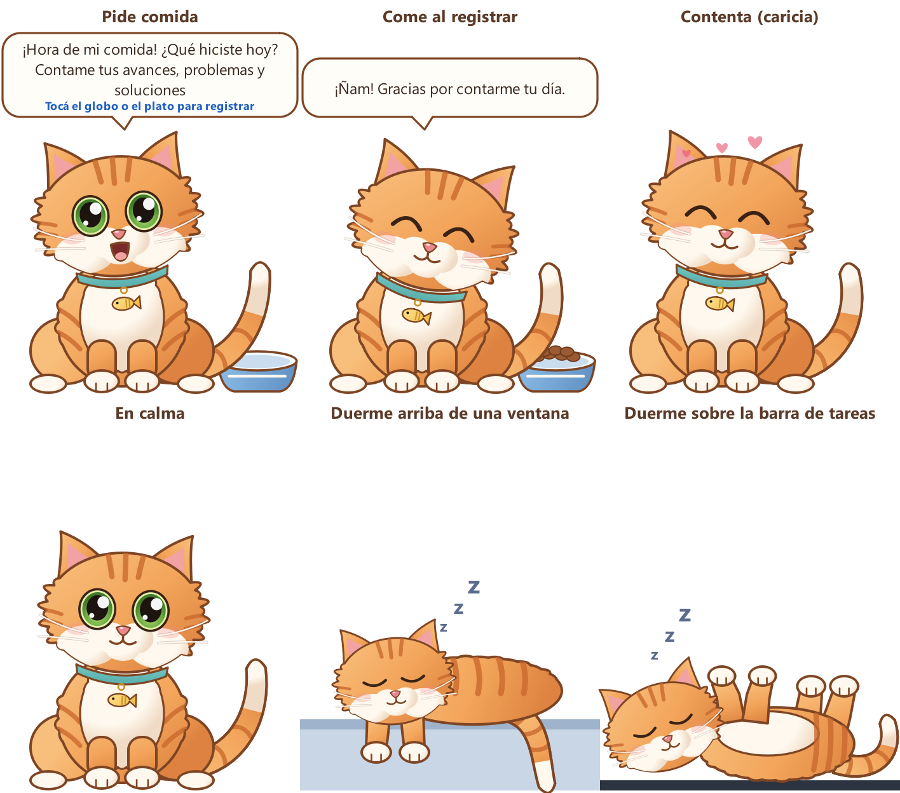

# CoraNotes

[](https://github.com/USUARIO_GITHUB/CoraNotes/actions/workflows/pruebas.yml)
[](https://github.com/USUARIO_GITHUB/CoraNotes/releases/latest)
[](LICENSE)



## Para quienes revisan el challenge

**Probarlo en 3 minutos (Windows 10/11, sin instalar nada, sin internet ni clave de Gemini):**

1. Descargá el zip de la [última versión](https://github.com/USUARIO_GITHUB/CoraNotes/releases/latest) (Assets →
   `CoraNotes-…-windows-x64.zip`). Antes de descomprimir: clic derecho → Propiedades → **Desbloquear**.
2. Descomprimilo y hacé doble clic en **`Demo CoraNotes.bat`**. Se abre el navegador y aparece Cora en el escritorio.
3. En Inicio presioná **Cargar datos ficticios** (un proyecto de VR industrial inventado). A los **2 minutos** Cora pide
   comida; hacé clic en su globo, guardá una actividad y mirá cómo come. A los **6 minutos** se prepara solo el prompt
   semanal para Claude (pantalla «Resumen y prompt»).
4. Clic derecho sobre Cora: tamaños, dónde duerme, **Opciones → Probar sonidos**. Para cerrar: `Detener Demo.bat`.

Si Windows muestra «Windows protegió su PC» al abrir un `.bat`: **Más información → Ejecutar de todas formas** (los
scripts no están firmados). La sección 12 tiene una demostración guiada de 10 minutos.

**Qué cubre:**

| Pedido del challenge | Dónde verlo |
|---|---|
| Registro diario local, borradores, papelera, revisiones y exportación Markdown | Registro diario e Historial (secciones 5 y 10) |
| Recordatorio condicional con días, horarios, zona horaria, excepciones y posponer | Configuración, y Cora a la hora configurada (secciones 5 y 8) |
| Mascota de escritorio que se alimenta registrando el día | Cora (sección 8) |
| Carpeta de entrada (.txt, .md, .json, .docx, .pdf e imágenes) | Configuración → Carpeta de entrada (sección 6) |
| Resumen con Gemini (con consentimiento), plantilla sin IA y modo demo | Resumen y prompt (sección 7) |
| Prompt para Claude con versiones, ediciones manuales, cierre semanal e instantáneas | Resumen y prompt (sección 7) |
| Seguridad: solo 127.0.0.1, CSRF, validaciones, sin secretos en logs, inyección de prompts | Sección 11 |
| Pruebas automáticas (reloj, notificaciones y Gemini simulados) | `tests/` y el indicador «Pruebas» de arriba (sección 13) |

**Decisiones del alcance:** la app **no** envía nada a Claude ni automatiza el navegador (el prompt se copia a mano),
y la demo funciona sin Gemini. Para usar Gemini de verdad hace falta una clave propia (sección 3).

---

Aplicación local para Windows, de un solo usuario. Sirve para:

1. **Registrar tus actividades diarias** (proyecto, actividad, avance, problemas, solución, próximos pasos y evidencias).
2. **Recordarte** completar los días sin registro con **Cora, una gatita animada que vive en tu escritorio**: registrar el día
   equivale a darle de comer. La notificación de Windows queda como respaldo.
3. **Preparar un prompt semanal** para que lo pegues en Claude, donde ya tenés tu diseño de presentaciones.
   El resumen lo arma Gemini o una plantilla sin IA.

> **Qué NO hace:** no envía nada a Claude, no automatiza el navegador, no guarda credenciales de Claude y no genera
> la presentación. El último paso (pegar el prompt en Claude y revisar la presentación) lo hacés vos.

---

## Descargar y usar (versión portable)

La forma más simple: **no hay que instalar nada**, ni Python ni librerías.

1. Descargá `CoraNotes-<versión>-windows-x64.zip` (unos 110 MB).
2. **Antes de descomprimir:** clic derecho sobre el zip → **Propiedades** → marcá **Desbloquear** → Aceptar.
   Así Windows no marca cada archivo como «descargado de internet».
3. Descomprimilo donde quieras, por ejemplo en `Documentos\CoraNotes`. Evitá «Archivos de programa».
4. Doble clic en **`Iniciar CoraNotes.bat`**. Se abre el navegador y aparece Cora en el escritorio.
   El primer inicio puede tardar hasta un minuto.

Requisitos: Windows 10 u 11 de 64 bits. La carpeta trae su propio Python 3.13 (paquete oficial de python.org) y
todas las librerías, y no necesita internet salvo para usar Gemini. Si Windows muestra «Windows protegió su PC»
al abrir un `.bat`, elegí **Más información → Ejecutar de todas formas** (pasa con archivos descargados que no
están firmados).

**Actualizar a una versión nueva:** detené la app, reemplazá la carpeta por la nueva y volvé a iniciar. Tus datos
viven aparte, en `%LOCALAPPDATA%\CoraNotes`, así que se conservan. Tu `.env`, si lo creaste, copialo a la carpeta nueva.

Para trabajar sobre el código (desarrollo, pruebas o armar el zip) seguí la sección 2.

## Índice

1. [Decisiones de diseño](#1-decisiones-de-diseño)
2. [Instalación desde el código (desarrollo)](#2-instalación-desde-el-código-desarrollo)
3. [Clave de Gemini (opcional)](#3-clave-de-gemini-opcional)
4. [Iniciar y detener](#4-iniciar-y-detener)
5. [Uso diario](#5-uso-diario)
6. [Carpeta de entrada y formatos](#6-carpeta-de-entrada-y-formatos)
7. [Prompt, versiones y cierre semanal](#7-prompt-versiones-y-cierre-semanal)
8. [Cora, la mascota de escritorio, y notificaciones](#8-cora-la-mascota-de-escritorio-y-notificaciones)
9. [Inicio automático con Windows (opcional)](#9-inicio-automático-con-windows-opcional)
10. [Copias de seguridad, retención y borrado](#10-copias-de-seguridad-retención-y-borrado)
11. [Privacidad y seguridad](#11-privacidad-y-seguridad)
12. [Demostración guiada de 10 minutos](#12-demostración-guiada-de-10-minutos)
13. [Pruebas automáticas](#13-pruebas-automáticas)
14. [Estructura del proyecto y versión portable](#14-estructura-del-proyecto-y-versión-portable)
15. [Solución de problemas](#15-solución-de-problemas)
16. [Limitaciones y mejoras futuras](#16-limitaciones-y-mejoras-futuras)

---

## 1. Decisiones de diseño

| Tema | Decisión | Por qué |
|---|---|---|
| Lenguaje y backend | Python 3.11+ con FastAPI y Uvicorn, sin autoreload y con 1 worker | Simple, un solo proceso |
| Base de datos | SQLite en modo WAL, con transacciones y consultas parametrizadas | Sin servidor y con escrituras atómicas |
| Interfaz | HTML, CSS y JavaScript sin frameworks | Nada que compilar |
| IA | SDK oficial `google-genai` (`generate_content` con salida JSON validada) | Verificado en la documentación oficial de Gemini en octubre de 2026 |
| Modelo por defecto | `gemini-3.8-flash` | Modelo Flash recomendado, con nivel gratuito según la página oficial de precios |
| Cora (mascota de escritorio) | Proceso aparte con **PySide6-Essentials 6.12** (Qt for Python, licencia LGPL), dibujado en código, con ventana sin marco que no toma el foco e icono en la bandeja | Vive fuera del navegador y consulta al backend local |
| Notificaciones | Cora es el canal principal. La notificación de Windows (vía PowerShell) es el respaldo cuando Cora está oculta o cerrada. Siempre hay aviso persistente dentro de la app | Nunca se avisa dos veces por los dos canales |
| Programación | Tabla `ejecuciones` con clave única por aviso y por cierre, más un bloqueo de instancia única | Ni los reinicios ni varias ventanas duplican avisos |
| Datos | `%LOCALAPPDATA%\CoraNotes\` (con subcarpetas `datos`, `adjuntos`, `historial`, `copias`, `logs` y `run`) | Datos separados del código; no requiere administrador |
| Documentos importados con fecha y proyecto claros | Se convierten en registros válidos automáticamente | Escribiste la fecha a propósito. Sin fecha o sin proyecto quedan como «pendiente de clasificar» |

---

## 2. Instalación desde el código (desarrollo)

> Si descargaste la **versión portable** (zip con la carpeta `runtime`), salteá esta sección: ya está todo incluido.

### 2.1 Instalar Python

1. Entrá a <https://www.python.org/downloads/> y descargá **Python 3.12** (sirve 3.11 o superior).
2. En el instalador, **marcá «Add python.exe to PATH»** y presioná *Install Now*. No hacen falta permisos de administrador.
3. Comprobá la instalación abriendo **PowerShell** (menú Inicio → escribí «PowerShell») y ejecutando:

```powershell
python --version
```

Tiene que mostrar `Python 3.12.x` (o 3.11 o superior).

### 2.2 Preparar la carpeta del proyecto

Guardá la carpeta del proyecto donde quieras, por ejemplo `C:\Users\<vos>\Documents\CoraNotes`. Después, en PowerShell:

```powershell
cd "C:\Users\<vos>\Documents\CoraNotes"
```

La primera vez que inicies la app, el script crea automáticamente el entorno `.venv` e instala las dependencias
exactas de `requirements.txt`. Necesita internet y tarda unos minutos.

**Reparación automática:** antes de cada inicio, el script comprueba que `.venv` funcione de verdad. Si se copió de
otra PC o lo creó un Python que ya no está, lo borra y lo vuelve a crear solo. Si no encuentra Python en el PATH pero
tenés [uv](https://docs.astral.sh/uv/) instalado, lo usa para descargar Python 3.12 dentro del proyecto, sin
permisos de administrador.

> Si vas a copiar el proyecto a otra computadora o mandarlo en un zip, **no incluyas** `.venv`, `.env` ni las
> carpetas de datos: el iniciador vuelve a crear el entorno allá.

> Si PowerShell bloquea los scripts («la ejecución de scripts está deshabilitada»), usá los archivos `.bat`
> (doble clic) o anteponé `powershell -ExecutionPolicy Bypass -File`, como en los ejemplos de abajo. Eso no cambia
> la configuración de seguridad de Windows.

---

## 3. Clave de Gemini (opcional)

**La app funciona sin clave**, en modo «Sin IA (plantilla)». Usar Gemini es opcional.

### 3.1 Crear la clave en Google AI Studio

1. Entrá a <https://aistudio.google.com/> con tu cuenta de Google.
2. Abrí **«Get API key» / «Obtener clave de API»** y elegí **«Create API key»**.
3. Copiá la clave. **No la pegues en ningún chat** (tampoco en este) ni la compartas.

### 3.2 Guardarla localmente

```powershell
Copy-Item .env.example .env
notepad .env
```

En el Bloc de notas, completá la línea `GEMINI_API_KEY=` con tu clave, guardá y cerrá. El archivo `.env` está
en `.gitignore`. Solo lo lee el backend: nunca se envía al navegador, ni se guarda en logs, exportaciones o copias.

### 3.3 Elegir el modelo

En `.env`, la variable `GEMINI_MODEL` define el modelo. Según la documentación oficial (octubre de 2026), estos tienen nivel gratuito:

- `gemini-3.8-flash`: el valor por defecto, recomendado.
- `gemini-3.5-flash-lite`: más liviano; suele tener más cuota diaria.

**Importante:**

- La disponibilidad y las cuotas dependen de tu cuenta y pueden cambiar. Revisalas en <https://ai.google.dev/gemini-api/docs/pricing>
  y en la sección de límites de AI Studio.
- La app **no habilita facturación, no cambia de modelo y no agrega funciones pagas**. Si tu proyecto de Google ya
  tiene facturación activa, la app **no puede garantizar** que el uso sea gratuito.
- Si el modelo no está disponible para tu cuenta, vas a ver el error «modelo no disponible». En ese caso, cambiá `GEMINI_MODEL`.

### 3.4 Activar Gemini en la app

Gemini queda **desactivado hasta que des tu consentimiento**:

1. Abrí la app y andá a **Configuración → Inteligencia artificial**.
2. Leé qué texto se envía y presioná **«Entiendo y acepto enviar ese texto a Gemini»**.
3. Elegí **Modo: Gemini** y presioná **Guardar IA**.

Reiniciá la app después de cambiar `.env` (con `detener` e `iniciar`).

---

## 4. Iniciar y detener

| Acción | Doble clic | PowerShell |
|---|---|---|
| Iniciar | `Iniciar CoraNotes.bat` | `powershell -ExecutionPolicy Bypass -File .\scripts\iniciar.ps1` |
| Detener | `Detener CoraNotes.bat` | `powershell -ExecutionPolicy Bypass -File .\scripts\detener.ps1` |
| Demo (datos ficticios) | `Demo CoraNotes.bat` | `powershell -ExecutionPolicy Bypass -File .\scripts\iniciar.ps1 -Demo` |
| Detener la demo | `Detener Demo.bat` | `powershell -ExecutionPolicy Bypass -File .\scripts\detener.ps1 -Demo` |
| Reiniciar la demo desde cero | `Reiniciar Demo.bat` | `powershell -ExecutionPolicy Bypass -File .\scripts\reiniciar_demo.ps1` |

- Al iniciar se abre el navegador en <http://127.0.0.1:8765/> (la demo usa <http://127.0.0.1:8766/>) y aparece el
  **Cora** en la esquina inferior derecha del escritorio. Para iniciar sin Cora: `iniciar.ps1 -SinMascota`.
- Si cerraste a Cora o quitaste su icono de la bandeja: doble clic en `Mostrar Cora.bat`, o en la web
  Inicio/Configuración → **Mostrar a Cora**.
- **Podés cerrar el navegador y la ventana de PowerShell:** el backend sigue en segundo plano, controlando
  recordatorios, la carpeta de entrada y la cola de IA. Para volver a la app, abrí la misma dirección o ejecutá iniciar de nuevo.
- Si ya está en ejecución, iniciar solo abre el navegador. No pueden correr dos backends a la vez porque un bloqueo de instancia única lo impide.
- `detener` cierra a Cora y después el backend, primero de forma ordenada. Si algo no responde, finaliza el proceso.
- **Cerrar a Cora no es lo mismo que detener la app.** «Cerrar a Cora» (en su menú) solo cierra la mascota:
  los recordatorios siguen, por notificación de Windows. «Detener todo CoraNotes…» o `Detener CoraNotes.bat` apagan todo.

---

## 5. Uso diario

**Inicio** muestra:

- el estado de hoy, los recordatorios activos (con **Posponer 15 min** y **Descartar aviso**) y las próximas ejecuciones;
- el estado de Gemini y del prompt, el estado del proceso local y los avisos persistentes.

**Registro diario:**

- Completá **fecha, proyecto y actividad** (obligatorios para guardar) y el resto de los campos opcionales.
- **Tarea** sirve para vincular avances del mismo trabajo. Por ejemplo, un bloqueo abierto el lunes y resuelto el miércoles en la misma tarea se reconoce como resuelto.
- Hay tres acciones:
  - **Guardar registro:** guarda en la computadora. No usa internet ni Gemini.
  - **Guardar borrador:** guarda sin completar el día.
  - **Hoy no hubo actividad para registrar:** completa el día sin actividad. Si después agregás actividad, la declaración se quita sola.
- El texto que escribís se guarda además en el navegador mientras tipeás. Si algo falla, no se pierde.
- Las **evidencias** (PNG, JPEG, PDF y PPTX) quedan en la computadora y **nunca se envían a Gemini**.

**Cuándo un día cuenta como registrado:** cuando tiene al menos un registro válido guardado (no borrador, con
actividad y sin estar en la papelera) o la declaración «sin actividad». Un borrador, un archivo suelto, una imagen
o un error de importación no completan el día.

**Historial y documentos:** permite filtrar, editar, ver revisiones, descargar `.md`, excluir un registro del resumen,
mandarlo a la **papelera**, restaurarlo, y clasificar o ignorar los documentos importados.

Cada registro tiene un ID estable (`REG-XXXXXXXX`). Cada cambio crea una revisión y además se exporta una copia
legible en Markdown a `historial\registros\AAAA\MM\`.

---

## 6. Carpeta de entrada y formatos

En **Configuración → Carpeta de entrada** elegí una carpeta **exclusiva**, por ejemplo con
**«Crear y usar la carpeta sugerida»** (`Documentos\CoraNotes - Entrada`). No se aceptan una unidad completa, tu
carpeta de usuario, Escritorio, Documentos o Descargas enteros, ni carpetas de la app.

| Formato | Qué hace la app |
|---|---|
| `.txt`, `.md` | Lee los metadatos y las secciones (ver plantilla) |
| `.json` | Lee un objeto con los campos de la plantilla |
| `.docx` | Extrae el texto con python-docx. Rechaza macros y aplica límites al tamaño descomprimido |
| `.pdf` | Extrae el texto seleccionable con pypdf. **No hace OCR**: si el PDF no tiene texto, lo informa |
| `.png`, `.jpg` | Los guarda como evidencia local. No los analiza ni los envía a Gemini |

Las plantillas están en [`ejemplos/plantilla_registro.md`](ejemplos/plantilla_registro.md) y
[`ejemplos/plantilla_registro.json`](ejemplos/plantilla_registro.json). Las claves aceptadas son `fecha`
(AAAA-MM-DD o DD/MM/AAAA), `proyecto`, `tarea`, `tipo_avance` (exploración / en curso / validado),
`estado_problema` (sin problema / abierto / en curso / resuelto). Las secciones aceptadas son `Actividad realizada`,
`Avance o resultado`, `Problemas`, `Solución o estado del problema` y `Próximos pasos`.

**Reglas de importación:**

- **Sin fecha o sin proyecto claros:** el archivo queda como «pendiente de clasificar» y vos confirmás esos datos en Historial. La fecha **nunca** se deduce de la fecha de modificación del archivo.
- **Escritura y duplicados:** la app espera a que el archivo termine de escribirse. Deduplica por ruta y por contenido (SHA-256) y guarda una versión cada vez que el archivo cambia.
- **Cambios y conflictos:** si cambia un archivo ya importado, se actualiza **el mismo registro** con una nueva revisión. Si editaste ese registro en la app, no se sobrescribe y se marca «conflicto».
- **Originales:** nunca se modifican.
- **Archivos quitados:** si quitás un archivo de la carpeta, el registro **no se borra**. Aparece un aviso y podés archivarlo.
- **Límites (configurables):** 2 MB para texto y JSON, 10 MB para documentos y evidencias, 50 páginas de PDF, 100.000 caracteres extraídos y 30 MB de DOCX descomprimido.
- **Rechazos:** enlaces simbólicos, *junctions*, rutas fuera de la carpeta, nombres raros, archivos temporales y binarios disfrazados. Las URLs dentro de los documentos no se descargan.
- **Errores:** los archivos ilegibles se listan con la causa.

---

## 7. Prompt, versiones y cierre semanal

**Pantalla Resumen y prompt.** El resumen se reconstruye **siempre desde los registros vigentes del período**. Nunca
reescribe el resumen anterior.

**Botones:**

| Botón | Qué hace |
|---|---|
| Actualizar prompt | Regenera el **borrador automático** solo si cambiaron los datos. Usa un hash de registros y configuración |
| Preparar para Claude | Revisa si hay cambios y crea una **instantánea** del prompt para copiar |
| Copiar prompt / Descargar .md o .txt / Abrir Claude | Copian, descargan o abren <https://claude.ai/new>. El envío lo hacés vos |

**Actualización automática:**

- Los cambios se agrupan durante 60 s antes de regenerar.
- La cola es persistente y procesa un solo trabajo a la vez, con timeout y un límite diario de llamadas a Gemini (configurable).
- Los errores transitorios se reintentan pocas veces y respetan `Retry-After`.
- **Si la cuota diaria se agota, no se reintenta solo hasta el día siguiente.**

**Estados del prompt:** actualizando, actualizado, cambios pendientes, error y sin contenido. Si cambia un registro
mientras Gemini responde, esa respuesta se descarta como obsoleta y se procesa la versión nueva.

**Mi versión editada:**

- Es independiente del borrador automático y **nunca se sobrescribe**.
- Si hay datos nuevos, vas a ver un aviso. Podés **reemplazar tu versión por el borrador** después de revisarlo, y la anterior queda en el historial.
- No hay fusión automática.

**Versiones:** cada versión guarda fecha, período, modo y modelo, fuentes (IDs y revisiones) y hashes. Podés verla,
compararla con el borrador, **recuperarla como copia** o descargarla.

**Cierre programado** (por defecto, viernes 18:30, semana laboral):

- Hace lo mismo que «Preparar para Claude» y te avisa que el prompt está listo. **No anuncia ninguna presentación.**
- Si Gemini falla, el cierre queda **pendiente**. Podés reintentar o usar la **plantilla sin IA (respaldo)**, que queda identificada como tal.
- Si no hay registros, informa que falta contenido y no inventa nada.
- Si registrás algo después del cierre, aparece **«Hay cambios posteriores al cierre»** con el botón **Crear otra versión**.
- Si el cierre ocurre antes del último recordatorio del período, la configuración te lo explica.
- Opcionalmente, podés **registrar la presentación terminada** con un enlace o una nota.

**Qué recibe Gemini:** solo el texto de los registros incluidos, con reglas explícitas:

- tratar las fuentes como datos;
- no inventar resultados, métricas, fechas, responsables ni conclusiones;
- citar IDs;
- distinguir exploración, trabajo en curso y resultados validados.

**Cómo se valida la respuesta:** se comprueba el esquema JSON y que los IDs existan. Lo que no tiene respaldo se
descarta. Un «resultado» sin un registro validado pasa a avances, y un problema «resuelto» sin un registro que lo
confirme pasa a «ambiguo». El prompt final para Claude **se construye por código** y lista las evidencias que tenés
que adjuntar a mano.

---

## 8. Cora, la mascota de escritorio, y notificaciones

Cora es una gatita naranja atigrada **dibujada en 2D por código** (estilo ilustración: contorno marrón suave,
ojos verdes grandes, pecho y patitas blancas, collar celeste con un pescadito dorado). Al ser vectorial se ve nítida
en los 3 tamaños: parpadea, mueve la cola y las orejas, respira, maúlla, come y duerme.

### Cómo se comporta

| Situación | Cora |
|---|---|
| Durante el día, antes del horario | Tranquila: parpadea, mueve la cola, duerme si no la tocás por 5 minutos y reacciona a las caricias |
| Pasó un horario configurado y **falta el registro de hoy** | Plato vacío y globo: «¡Hora de mi comida! ¿Qué hiciste hoy? Contame tus avances, problemas y soluciones» |
| Guardás una **actividad válida de hoy** (desde la web o con una importación válida) | Aparece comida, come y queda contenta. No espera a Gemini: reacciona en 1 a 3 segundos |
| Ya comió hoy | Alimentada. Agregar más actividades, editar, importar duplicados o reiniciar **no repite** la animación (se guarda en la base de datos) |
| «Hoy no hubo actividad», días sin recordatorio, excepciones o pausa | Descansa (duerme). Sin hambre |
| Sin conexión con el backend | Se ve en gris con «Conectando con CoraNotes…» y se sincroniza solo al volver |

**No alimentan a Cora:** borradores, archivos vacíos, capturas sueltas, documentos pendientes de clasificar ni
actividades de otros días. El «hoy» se calcula con la zona horaria configurada. No hay enfermedad, muerte ni
mensajes que culpen.

### Interacciones

- **Clic en el plato o en el globo:** abre el formulario de registro del día actual.
- **Clic en Cora:** caricia (corazones).
- **Arrastrar:** la mueve. La posición se guarda y, si cambiás de monitor o de resolución, vuelve al área visible.
- **Clic derecho** (o clic derecho en el icono de la bandeja):
  - Registrar actividades de hoy, Abrir CoraNotes y Posponer recordatorio (15 min).
  - Ocultar a Cora (queda en la bandeja), Silenciar recordatorios hasta mañana.
  - **Tamaño:** chico, mediano o grande (el chico ocupa unos 140 × 125 píxeles de gato).
  - **Dónde duerme:** en su lugar del escritorio, arriba de la ventana activa o panza arriba sobre la barra de tareas.
  - Opciones: mantener sobre otras ventanas, reducir animaciones y maullidos.
  - Cerrar a Cora y Detener todo CoraNotes.
- **Icono de la bandeja:** un clic vuelve a mostrar a Cora si estaba oculta. Si el icono no se ve, revisá la flecha «^» de la barra de tareas.
- **Configuración web → Cora, la mascota de escritorio:** tamaño, dónde duerme, mantenerla visible, maullidos,
  reducir animaciones, notificación de respaldo y volver a la esquina.

### Dónde duerme

Cora se duerme cuando el día está en descanso o cuando no la tocás por 5 minutos. Según la opción elegida:

| Opción | Qué hace |
|---|---|
| En su lugar del escritorio (por defecto) | Se duerme sentada donde la dejaste |
| Arriba de la ventana activa | Se acuesta sobre el borde superior de la ventana activa, con las patitas y la cola colgando. Si movés la ventana, la sigue. Las ventanas **maximizadas** no dejan lugar arriba: en ese caso duerme sobre la barra de tareas |
| Panza arriba sobre la barra de tareas | Se acuesta panza arriba justo encima de la barra de tareas |

Cuando se despierta (porque la acariciás, la arrastrás o tiene hambre), vuelve a su lugar. Para ubicarse solo lee
**la posición y el tamaño** de las ventanas: nunca títulos, contenido ni capturas de pantalla.

### Maullidos y sonidos

Los sonidos se generan por código, sin grabaciones ni descargas: un maullido «miau» para pedir comida, un trino
contento al comer y un ronroneo con las caricias. Vienen **activados**; se apagan con clic derecho → Opciones →
Maullidos, o desde Configuración.

Para escucharlos cuando quieras: clic derecho sobre Cora → Opciones → **Probar sonidos** (suenan aunque estén apagados).

Cuando Cora está oculta o cerrada y avisa la notificación de Windows, la notificación sale sin su sonido propio y
suena el maullido, para que no suenen dos cosas a la vez. Con los maullidos apagados, Windows usa su sonido normal.

### Qué canal avisa (sin duplicados)

| Estado de Cora | Aviso a la hora configurada |
|---|---|
| Visible y conectada | Cora pide comida. En la app queda un aviso que dice que Cora avisó. **Sin** notificación de Windows |
| Oculta en la bandeja, cerrada o desactivada | Notificación de Windows, si «notificación de respaldo» está activada (por defecto, sí) |
| Respaldo desactivado | Solo aviso dentro de la app |
| «Silenciar hasta mañana» | Ningún aviso hoy |

### Seguridad y consumo

- Cora usa un token local (`run\mascota.token`) que solo sirve para las rutas `/api/mascota/`. **No conoce la clave de Gemini.**
- No captura pantalla, teclado global, cámara ni micrófono, y no hace llamadas a Gemini: sus animaciones son locales.
- Su ventana no toma el foco, se muestra sin activarse y es transparente fuera del dibujo.
- Hay una sola instancia: abrirla de nuevo solo muestra la que ya existe.
- Consulta al backend cada 3 segundos. Cuando está oculta, casi no redibuja.

### Notificación de Windows (respaldo)

- Para probarla: Configuración → **Probar notificación de Windows**. La app informa si se **entregó a Windows**, pero
  **no puede saber si la viste**: con «No molestar» Windows puede ocultarla. Aparece con el nombre «Windows PowerShell».
- **Requisitos:** PC encendida y activa, y la app en ejecución. Al volver de un apagado o una suspensión, la app
  reconcilia lo pendiente y muestra **un solo aviso agrupado**.
- «Descartar aviso» **no** registra el día.

## 9. Inicio automático con Windows (opcional)

Está **desactivado por defecto** y solo se activa si vos lo elegís. Crea un acceso directo en tu carpeta «Inicio»:
no usa tareas programadas ni permisos de administrador.

```powershell
powershell -ExecutionPolicy Bypass -File .\scripts\inicio_automatico.ps1 -Activar
```

```powershell
powershell -ExecutionPolicy Bypass -File .\scripts\inicio_automatico.ps1 -Desactivar
```

---

## 10. Copias de seguridad, retención y borrado

- **Crear una copia:** Configuración → **Crear copia ahora**. Se genera `copias\coranotes-copia-AAAAMMDD-HHMMSS.zip` con la
  base de datos, los adjuntos y el historial. **No incluye `.env` ni la clave.** La copia **no está cifrada**: guardala en un lugar protegido.
- **Restaurar una copia** (con la app detenida):

```powershell
powershell -ExecutionPolicy Bypass -File .\scripts\detener.ps1
```

```powershell
powershell -ExecutionPolicy Bypass -File .\scripts\restaurar_copia.ps1 -Archivo "$env:LOCALAPPDATA\CoraNotes\copias\coranotes-copia-AAAAMMDD-HHMMSS.zip"
```

  Los datos actuales **no se borran**: se mueven a `resguardo-antes-de-restaurar-<fecha>` dentro de la carpeta de datos.
- **Retención:** la app conserva todo (registros, revisiones, versiones, instantáneas y avisos) hasta que lo borres vos.
- **Purgado explícito:**
  - Historial → filtro «Papelera» → **Eliminar definitivamente**. Borra el registro y sus revisiones.
  - Para borrar todo: detené la app y eliminá la carpeta `%LOCALAPPDATA%\CoraNotes`.
- Los archivos locales **no están cifrados automáticamente**. Si lo necesitás, usá BitLocker o una carpeta cifrada.
- **Borrar datos locales no borra lo que ya se haya enviado a Gemini.**

---

## 11. Privacidad y seguridad

**IA:**

- La sincronización con Gemini está **desactivada hasta que des tu consentimiento** en la app.
- Podés revisar exactamente qué texto se enviaría (en Resumen y prompt), excluir registros y pausar la IA.
- En el **nivel gratuito, Google puede usar el contenido para mejorar sus productos**, según sus condiciones. No uses
  Gemini con información confidencial de la empresa: la app no promete confidencialidad empresarial.
- Nunca se envían adjuntos, imágenes, carpetas, la clave ni la configuración.
- La IA **no recibe herramientas**: no puede ejecutar comandos, leer archivos, cambiar la configuración ni enviar mensajes.
  Ninguna instrucción dentro de una nota habilita acciones.

**Servidor local:**

- Escucha solo en 127.0.0.1.
- Valida `Host` y `Origin` y no habilita CORS.
- Toda escritura exige un token CSRF de sesión con cookie `HttpOnly` y `SameSite=Strict`. La cookie no lleva `Secure` porque el servidor local es http.
- Ninguna petición GET modifica datos.
- Tiene una CSP estricta, sin scripts ni estilos en línea.
- **Escuchar solo en 127.0.0.1 reduce riesgos, pero no es una garantía absoluta:** otros programas de la misma PC podrían intentar comunicarse con el servidor.

**Datos:**

- SQL parametrizado y validación de entradas.
- El texto de usuario se muestra siempre como texto (sin HTML crudo), y el Markdown se renderiza de forma segura.
- Los adjuntos se sirven solo por ID interno, con tipos MIME restringidos.
- Los logs son técnicos y mínimos: no contienen texto de actividades. La clave se enmascara en logs, respuestas y exportaciones.

**Inyección de prompts:** estas medidas **reducen** el riesgo, pero **no lo eliminan por completo**. Revisá siempre el prompt antes de usarlo.

---

## 12. Demostración guiada de 10 minutos

La demo usa **datos ficticios** (un simulador de VR de mantenimiento industrial) y el **proveedor simulado**: no
consume la API. Tiene una carpeta de datos y un puerto separados, así que no toca tus datos reales.

| Minuto | Paso |
|---|---|
| 0 | Doble clic en `Demo CoraNotes.bat`. Se abre <http://127.0.0.1:8766/> con la etiqueta **MODO DEMO** y aparece **Cora** abajo a la derecha. Acariciala (clic) y arrastrala |
| 1 | En Inicio, presioná **Cargar datos ficticios**. Se crean 5 registros de días anteriores, un **borrador** de hoy (que no completa el día), una evidencia PNG, un **recordatorio puntual en 2 minutos**, un **cierre en 6 minutos** y una carpeta de entrada de demo con 3 archivos de ejemplo |
| 2 | **Historial:** dos archivos importados, uno «pendiente de clasificar» (clasificalo con una fecha y el proyecto) y la evidencia con miniatura |
| 3 | Cerrá la pestaña del navegador (el backend sigue). Al vencer el recordatorio, **Cora muestra el plato vacío y el globo**. Hacé clic en el globo: se abre el formulario de hoy. Guardá una actividad y mirá cómo **come**. Después, ocultala con clic derecho → Ocultar a Cora y recuperala desde el icono de la bandeja |
| 4 | **Resumen y prompt → Actualizar prompt.** Fijate en el bloqueo de *Importación de modelos CAD*, que figura **Resuelto** con los dos IDs, en la nota con una «instrucción inyectada», que queda como dato, y en las evidencias para adjuntar a mano |
| 5 | Editá **Mi versión** y guardala. Después cargá un registro nuevo y presioná **Actualizar prompt**: aparece un borrador nuevo y tu versión se conserva. Probá **Diferencias** y **Recuperar como copia** |
| 6 | Esperá el **cierre programado**: llega un aviso «prompt listo» que aclara que **no se generó ninguna presentación**. La instantánea aparece en la lista |
| 7 | Registrá algo más: el cierre muestra **«Hay cambios posteriores al cierre»** y el botón **Crear otra versión** |
| 8 | **Copiar prompt → Abrir Claude.** Pegás vos el prompt en tu proyecto de Claude |
| 9 | Configuración: cambiá días y horario o agregá una excepción en el calendario, y mirá cómo cambian las «Próximas ejecuciones» en Inicio. Probá **Crear copia ahora** |
| 10 | Detené la demo con `Detener Demo.bat` (cierra también a Cora) |

**Para repetir la demo desde cero** (por ejemplo, después de ensayarla): doble clic en `Reiniciar Demo.bat`.
Detiene la demo, borra **solo** sus datos ficticios (`%LOCALAPPDATA%\CoraNotes-demo` y `...-demo-entrada`) y la
vuelve a iniciar. Tus datos reales no se tocan.

**Consejo para presentar:** reiniciá la demo antes de empezar y presioná «Cargar datos ficticios» **justo antes de
mostrar a Cora**. El recordatorio llega a los 2 minutos y el cierre a los 6.

> La notificación real de Windows y el aspecto de Cora en tu escritorio solo se pueden comprobar **a mano**,
> mirando la pantalla (ver la lista de abajo). Las pruebas automáticas usan un notificador simulado y Qt en modo
> «offscreen».

### Qué comprobar a mano en Windows (Cora)

1. **Hambre:** a la hora del recordatorio, sin registro de hoy, aparecen el plato vacío y el globo. **No** debería
   aparecer además una notificación de Windows.
2. **Sin aviso:** con un registro válido de hoy guardado antes del horario, no pide comida.
3. **Comer:** clic en el globo → formulario → Guardar registro. En 1 a 3 segundos Cora come y queda contenta.
4. **Sin Gemini:** sin clave en `.env` (modo plantilla), todo lo anterior funciona igual.
5. **Persistencia:** detené la app y volvé a iniciarla. Cora sigue alimentada y **no** repite la animación.
6. **Sin duplicados:** agregá otra actividad o editá una. No vuelve a comer.
7. **Bandeja:** clic derecho → Ocultar. Desaparece y queda el icono; un clic en el icono lo trae de vuelta.
8. **Foco:** mientras escribís en otra aplicación, Cora no te quita el teclado.
9. **Monitores:** arrastralo a otro monitor y desconectalo (o cambiá la resolución). Vuelve al área visible.
10. **Cerrar o detener:** «Cerrar a Cora» deja la web funcionando. «Detener todo CoraNotes…» apaga todo.

---

## 13. Pruebas automáticas

```powershell
powershell -ExecutionPolicy Bypass -File .\scripts\probar.ps1
```

Las pruebas usan **reloj, notificaciones y Gemini simulados**: no consumen la API ni la red. Están en [`tests/test_coranotes.py`](tests/test_coranotes.py).

| # | Escenario | Prueba |
|---|---|---|
| 1 | Sin registro hay aviso; con registro válido, no. Además, posponer y descartar | `test_1_*` |
| 2 | Un archivo de ayer, vacío o sin clasificar no cancela el aviso; «sin actividad» sí | `test_2_*` |
| 3 | Reinicios y varias ventanas no duplican; instancia única; aviso agrupado al reanudar | `test_3_*`, `test_3b_*` |
| 4 | Cambiar días u horario, excepciones y pausa afecta las ejecuciones siguientes | `test_4_*` |
| 5 | Importar y corregir no duplica registros ni dispara bucles; conflicto con edición manual | `test_5_*`, `test_5b_*` |
| 6 | Un bloqueo resuelto cambia de estado y mantiene las fuentes; la IA no puede inventar | `test_6_*` |
| 7 | Una cuota agotada o un error de red no pierden datos ni reemplazan el último prompt | `test_7_*`, `test_7b_*` |
| 8 | Un cambio durante la generación no deja vigente una respuesta obsoleta | `test_8_*` |
| 9 | Regenerar conserva las ediciones manuales y las instantáneas | `test_9_*` |
| 10 | Host y Origin, CSRF, traversal, HTML malicioso, inyección, secretos, tamaños, DOCX inflado y junctions | `test_10*` |
| 11 | El cierre programado prepara el prompt y avisa sin anunciar una presentación; casos sin datos y con Gemini caído | `test_11_*`, `test_11b_*` |
| Cora | Hambre si falta el registro y nada si ya existe; come al guardar sin esperar a Gemini; funciona sin Gemini; recompensa única que persiste tras reiniciar; borradores, archivos, imágenes y días anteriores no cuentan; descanso, posponer y silenciar; canal Cora o Windows sin duplicar; zona horaria; token local; ventana sin foco, bandeja y límites de pantalla; dónde duerme (ventana y barra de tareas) y regreso al despertarse; maullidos sintetizados y notificación sin doble sonido (Qt offscreen) | [`tests/test_cora.py`](tests/test_cora.py) |

La prueba con **enlace simbólico** se omite si Windows no permite crearlos (requiere modo desarrollador). La
protección equivalente con *junction* sí se prueba.

---

## 14. Estructura del proyecto y versión portable

```
CoraNotes\
├─ Iniciar CoraNotes.bat · Detener CoraNotes.bat · Demo CoraNotes.bat · Detener Demo.bat · Reiniciar Demo.bat · Mostrar Cora.bat
├─ .env.example · .gitignore · requirements.txt (versiones exactas) · requirements.in · requirements-dev.txt
├─ coranotes\              código
│  ├─ __main__.py         arranque (uvicorn en 127.0.0.1, 1 worker, sin reload)
│  ├─ context.py          arma servicios e hilos de fondo
│  ├─ db.py · settings.py · records.py · calendar_logic.py · scheduler.py
│  ├─ notifier.py · importer.py · watcher.py · evidence.py · prompts.py · backup.py · demo.py
│  ├─ pet.py · pet_launcher.py   estado de Cora (backend) y arranque del proceso
│  ├─ mascota\            Cora, la mascota de escritorio (PySide6): logic, drawing, client, app, sound
│  ├─ ai\                 sources, schema, providers (Gemini/plantilla/simulado), prompt_builder, service (cola)
│  └─ web\                app.py (API), security.py, static\ (index.html, app.css, app.js)
├─ scripts\               iniciar, detener, mascota, reiniciar_demo, restaurar_copia, inicio_automatico, probar,
│                         empaquetar.py (arma la versión portable)
├─ ejemplos\              plantillas y archivos ficticios de la demo
└─ tests\                 pruebas automáticas
```

Datos (fuera del proyecto): `%LOCALAPPDATA%\CoraNotes\` → `datos\coranotes.sqlite3`, `adjuntos\`, `historial\`,
`copias\`, `logs\coranotes.log`, `run\`.

### Armar la versión portable (zip para distribuir)

Desde la carpeta del proyecto, con el entorno de desarrollo ya creado:

```powershell
.\.venv\Scripts\python.exe scripts\empaquetar.py
```

El script:

1. Descarga el **Python 3.13 «embeddable» oficial** de python.org y verifica su **SHA-256** y su **firma digital**
   (Python Software Foundation). Si algo no coincide, se detiene.
2. Instala adentro las librerías con las **versiones exactas** de `requirements.txt`, solo desde paquetes
   precompilados para Windows x64 (no compila nada).
3. Copia la app (sin pruebas, sin `.venv`, sin `.env` ni datos), genera `LEEME-PRIMERO.txt` y `TERCEROS.txt`
   (licencias de los componentes incluidos) y precompila los `.pyc` para que el primer inicio sea rápido.
4. Hace una prueba de humo con el Python incluido y genera:
   - `dist\CoraNotes\` (la carpeta lista para usar, unos 300 MB);
   - `dist\CoraNotes-<versión>-windows-x64.zip` (unos 110 MB) y su `.sha256`.

`build\` y `dist\` no se guardan en Git. Para publicar una versión: cambiá `__version__` en `coranotes\__init__.py`, hacé commit y creá una etiqueta
(`git tag v1.0.1` y `git push origin v1.0.1`). GitHub Actions corre las pruebas, arma el zip y lo publica solo
como *Release* (`.github/workflows/release.yml`).

La versión portable usa los mismos scripts que el código fuente: si existe la carpeta `runtime\`, usan ese Python y
no crean `.venv`.

---

## 15. Solución de problemas

| Problema | Qué hacer |
|---|---|
| «No se encontró Python» | Usá la versión portable (trae Python). Desde el código: instalá Python 3.12+ marcando «Add python.exe to PATH» |
| «El Python incluido en la carpeta runtime no arranca» | Volvé a descomprimir el zip, desbloqueándolo antes (Propiedades → Desbloquear) |
| «Windows protegió su PC» al abrir un `.bat` | Más información → Ejecutar de todas formas. Pasa con archivos descargados sin firma digital |
| «El entorno .venv no funciona en esta PC…» | No es un error: el iniciador lo está recreando. Esperá unos minutos (necesita internet) |
| «Los datos ficticios ya están cargados» | Usá `Reiniciar Demo.bat` para empezar la demo de nuevo |
| «El puerto 8765 está ocupado» | Poné `CORANOTES_PORT=8775` (u otro) en `.env` |
| La página no carga | Ejecutá iniciar. Si falla, revisá `%TEMP%\coranotes-arranque-8765.log` (el número es el puerto) y `%LOCALAPPDATA%\CoraNotes\logs\coranotes.log` |
| No veo notificaciones | Configuración → Probar notificación. Revisá Windows → Sistema → Notificaciones y «No molestar» |
| No veo a Cora | Doble clic en `Mostrar Cora.bat`. Revisá que esté activada en Configuración y mirá `%LOCALAPPDATA%\CoraNotes\logs\cora.log` |
| Cora queda detrás de otras ventanas | Clic derecho → Opciones → «Mantener sobre otras ventanas» |
| Cora en gris «Conectando…» | El backend no responde: ejecutá `Iniciar CoraNotes.bat` |
| Gemini «sin clave» | Completá `GEMINI_API_KEY` en `.env` y reiniciá la app |
| Gemini 401/403 | La clave no es válida o fue revocada. Creá otra en AI Studio |
| Gemini 404 / modelo | Cambiá `GEMINI_MODEL` por otro modelo disponible en tu cuenta |
| Gemini 429 / cuota | Esperá (se reintenta solo si es temporal) o usá la plantilla sin IA |
| «Sesión vencida» | Recargá la página (F5). El texto del formulario queda guardado en el navegador |

---

## 16. Limitaciones y mejoras futuras

- No hace OCR ni analiza imágenes.
- No fusiona automáticamente tu versión editada con el borrador nuevo.
- Las notificaciones y Cora dependen de Windows y de que la PC esté encendida y con la sesión iniciada.
- Los maullidos son sintéticos: suenan a gato de dibujo animado, no a una grabación real.
- Con varios monitores con distinta escala, la posición «arriba de la ventana» puede quedar unos píxeles corrida.
- Mejoras futuras, fuera del alcance de esta versión: envío automático a Claude (requiere API), varios usuarios,
  despliegue público, cifrado de datos en reposo y un instalador.
